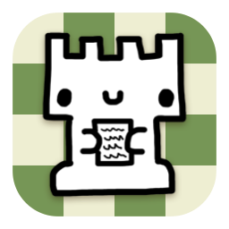
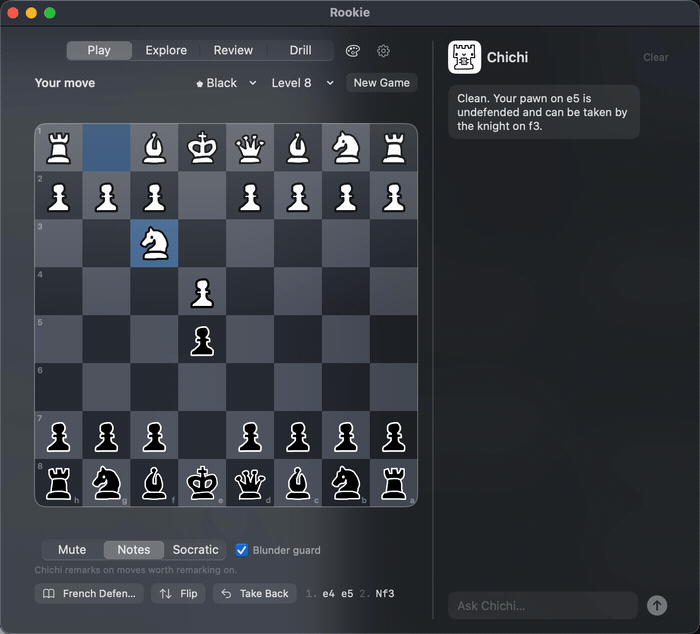
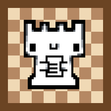
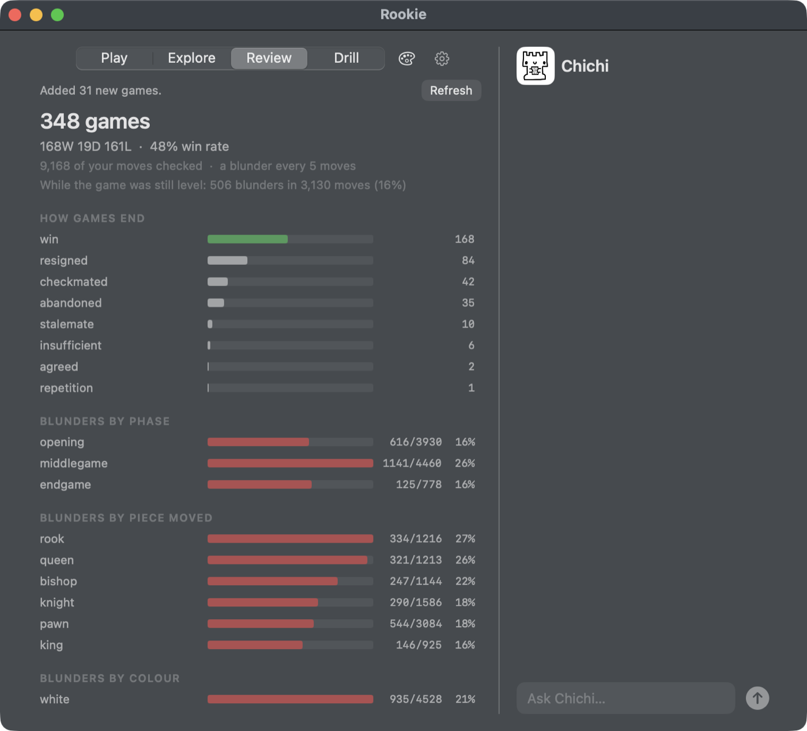
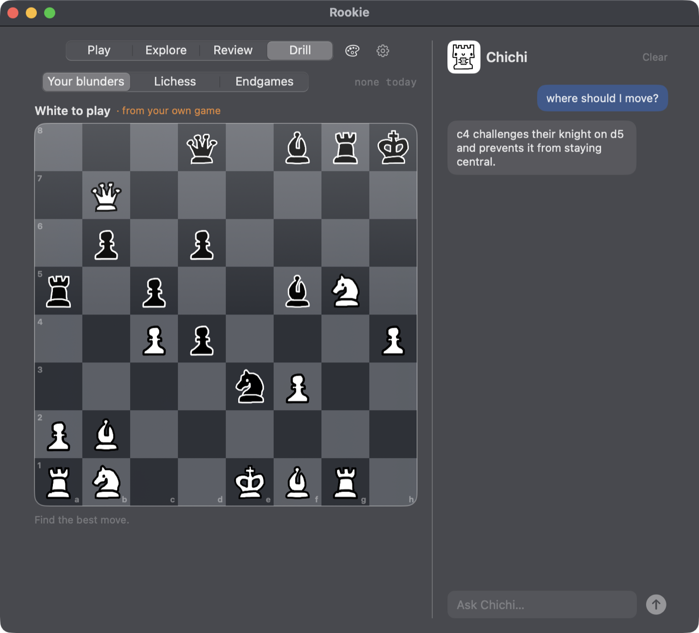

<p align="center">
  
</p>

<h1 align="center">Rookie</h1>

<p align="center">
  <b>An open source chess coach for macOS</b>
</p>

<p align="center">
  <a href="../../releases/latest/download/Rookie.zip"></a>
  <a href="https://ollama.com/download"></a>
  <a href="#installing-it"></a>
</p>

I'm not very good at chess and it bothers me, so I built this. Apps that I've
tried are great at telling you what went wrong after the game. I wanted
something that spoke up while the piece was still on the board.

It all runs on your Mac. No account and totally free.

The coach is a language model, run locally through
[Ollama](https://ollama.com). He only does the talking: Stockfish and the app
work out the moves and the threats before he sees them, so he can't invent a
move that isn't there.

<p align="center">
  
</p>

## Meet Chichi



Chichi is the coach, and he's chill about it. When a move goes wrong he tells
you what it cost and what to do next, then leaves it there. How much he says
is up to you, from a nod at a good move to a warning about the piece you're
about to throw away, and if you're stuck you can ask him for some options.

## Playing a game

You play Stockfish at eight levels, as either colour, and you can take moves
back.

If you're about to drop a piece, Rookie stops you and tells you what the move
would cost. You can play it anyway if you meant it.

Mute turns Chichi off. Notes gets you a remark on the moves worth remarking
on. Socratic holds the board and asks you a question about the move you just
played instead of telling you anything.

Ask Chichi anything in plain English about the current board and he'll do his
best to answer.

## Openings

Rookie has over 3,300 named openings, searchable. Step through a line move by
move, or hide the moves and drill it from memory. Point the Play tab at one
and it'll steer a real game towards it, then tell you who left the book first.

## Reviewing your real games

Link a chess.com account and Rookie pulls in every game you've played and
analyses them. The report shows where in the game your blunders arrive, which
pieces you keep dropping, and how your games actually end.

<p align="center">
  
</p>

## Drilling

Three sets of puzzles. The ones built out of your own blunders in those games,
30,000 from the Lichess set filtered to your rating, and tablebase endgames
worth knowing. Ask Chichi what a move does and he'll tell you, but he can't
tell you whether it's right, because the app hides the answer from him too.

<p align="center">
  
</p>

## Settings

The gear at the top right has your chess.com account, which side you play, and
the board themes and piece sets, including a hand-drawn one.

## Installing it

You need an Apple Silicon Mac on macOS 14 or later, and about 10 GB free.

1. Download `Rookie.zip` from [Releases](../../releases), unzip it, and drag
   Rookie to your Applications folder.
2. The first open needs a right-click. I haven't signed Rookie with an Apple
   developer certificate, so double-clicking it gets you "Apple could not
   verify it". Right-click the app, choose Open, then Open again in the dialog.
   Only the first launch needs this. (If you double-clicked first, it's in
   System Settings → Privacy & Security → Open Anyway.)
3. Install [Ollama](https://ollama.com/download), which runs the coach's model
   on your machine and is free.
4. Open Rookie. It'll offer to fetch what it still needs: the model (about
   8 GB, once), the opening list, and the puzzles. You can skip all of it and
   just play, and the checklist comes back next launch.

I built and tested Rookie against `gemma4:12b`. If that's too much model for
your Mac, Settings has a picker listing whatever you already have in Ollama. A
smaller one gives you a blunter coach, and the chess itself is worked out by
the engine either way.

Rookie carries its own Python and its own copy of Stockfish, so there's
nothing else to install.

## Privacy

Nothing you play is uploaded anywhere, and the coach runs locally through
Ollama. The only things that leave your Mac are the downloads above and, if
you ask for them, public data you already have: your own chess.com games, and
the Lichess opening explorer's move statistics.

## Building it yourself

```sh
./setup.sh        # Stockfish, Python, Ollama, the model, openings, puzzles
swift build && .build/debug/ChessCoach
./build-app.sh    # makes dist/Rookie.app and dist/Rookie.zip
```

`setup.sh` skips anything already installed. The app is the Swift in
`Sources/`, the engine and analysis half is the Python in `coachd/`, and they
talk over a Unix socket. `coachd` holds one warm Stockfish and answers
questions about the position, so nothing about a move is ever left to the
model.

## Licence

GPL-3.0. See `LICENSE`, and `NOTICE.md` for the bundled components and the
piece sets, each with its own licence and author.
x